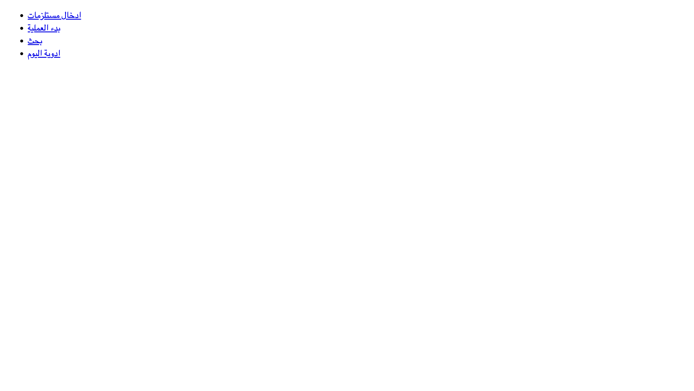
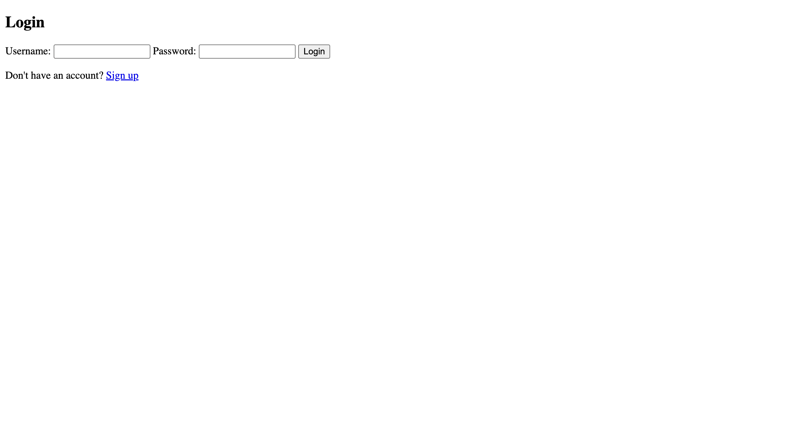

<div align="center">

# 🏥 Hospital Operations Tracker

**Electron · SQLite · Vanilla JS** — Arabic-first UI (نظام إدارة المستشفى)

Desktop app for hospital staff to track **supplies (مستلزمات)**, **surgeries (عمليات)**,
and **daily medications (أدوية اليوم)**.

</div>

<p align="center">
  
  
</p>

## ✨ Features

- 📦 **Supplies intake** (ادخال مستلزمات) with inventory tracking
- 🏥 **Operation workflow** (بدء العملية) management
- 💊 **Daily meds board** (أدوية اليوم)
- 🔍 Patient & supply search
- 🖨️ Print-ready reports (html2canvas)
- 🔐 Local accounts (login/signup) — SQLite storage
- 🇪🇬 Full Arabic RTL interface

## 🚀 Getting Started

```bash
npm install
npm start        # runs Electron
```

## 📁 Structure

```
main.js / preload.js   # Electron main process & secure IPC bridge
client/                 # renderer logic (login, signup, views)
model/                  # SQLite data layer
pages/                  # HTML screens (Arabic RTL)
style/                  # per-screen CSS
```

> Also see [hospital-full](https://github.com/mahmoudcod/hospital-full) — the newer
> TypeScript/Electron rewrite with automatic daily backups.
